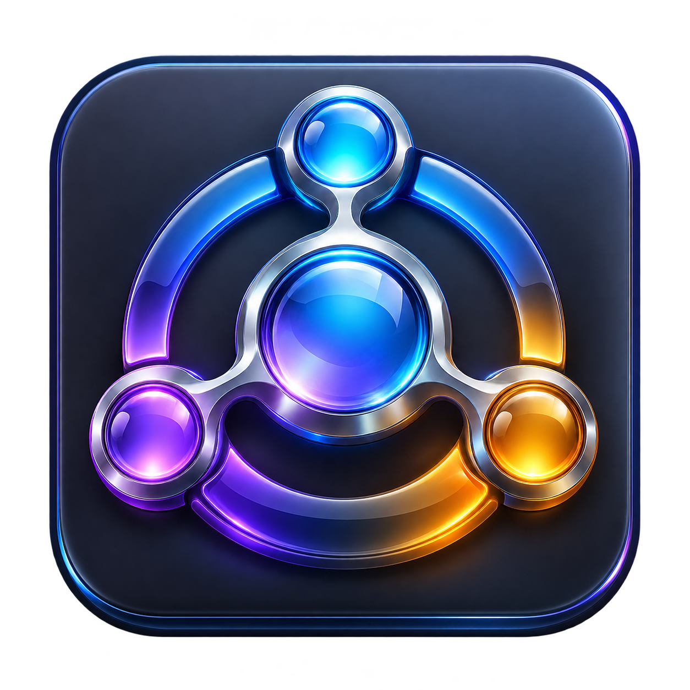

# AI Hub



A Windows desktop workspace for the AI apps you use. Installed or open AI apps
appear in the sidebar automatically. Connect other desktop apps or dedicated
browser windows with **Connect an AI**, keeping their existing accounts and
conversations. A dark, cyan HUD shows available usage monitors with remaining
allowance rings, reset countdowns and amber warnings. Save projects with their
AI apps, notes, links and window layout, then use the command palette to switch
between projects and tools. Version 0.7.0 adds two-AI split view, a local context
shelf for prepared handoffs, and usage history with clearly labeled estimates.

## Run

Download **AIHub-vX.Y.Z-windows-x64-Setup.exe** from [the latest public release](https://github.com/wernerong/ai-hub/releases/latest)
and double-click it. Close AI Hub first if upgrading. Setup installs for your
Windows account, creates shortcuts and registers a native uninstaller in
Installed apps. No administrator access, PowerShell commands, execution-policy
changes or ZIP extraction are needed. Existing settings remain in place.
The installer is currently unsigned, so Windows may show an unknown-publisher
or SmartScreen warning. Checksums are provided in `SHA256SUMS.txt`.

The ZIP remains available for portable use and automatic updates. To run it
portably, extract it to a writable folder and open `AIHub.exe`. Its legacy
PowerShell installation scripts are retained for compatibility; **Setup.exe**
is the recommended installation method.
The .NET runtime is included. Open or install your AI apps separately.

The version stays visible in the title bar and sidebar. **Pop out** restores
one app's original window; **Restore all** or closing the hub restores them all.

## Automatic updates

Version 0.3.0 is the first public release. It checks published stable GitHub
releases at startup and every six hours, verifies the download's SHA-256 digest,
and installs when AI Hub closes after restoring its app windows. In **Settings**,
choose **Check for updates**, **Restart to update**, or turn automatic updates off.
Updates do not need a GitHub account. Builds before 0.3.0 need one manual upgrade.
Your provider accounts, zoom choices and usage preferences stay in place.

Publishing a GitHub release delivers an update; pushing source alone does not.
The [local release script](docs/RELEASING.md) builds and uploads verified assets
without using GitHub Actions jobs, minutes, artifact storage or cache storage.

## Build and package

Requires Windows and the .NET 10 SDK. Packaging also requires Inno Setup 6.7+
(`ISCC.exe` on PATH or selected with the `INNO_SETUP_COMPILER` environment variable).

```powershell
.\Build.ps1
.\Package.ps1
```

Build writes to `dist`. Package builds, runs the Windows integration self-test,
and produces a native Setup.exe, a versioned ZIP and SHA-256 checksums in `artifacts`.
Pass `-OutputDirectory` to choose another destination. Package staging folders
must be new so stale files cannot enter a release.

## Behavior and limits

### Two-AI split view

Select **Split view** above the workspace, choose two different AIs, and select
**Open split**. Use the **Stack vertically (top and bottom)** checkbox for a
stacked layout; leave it off for side-by-side panes. The cyan **FOCUSED** pane
header identifies the active AI. Click inside an AI or its pane header to focus
it. A sidebar selection replaces the focused pane; selecting the AI already in
the other pane focuses that pane instead of duplicating it.

Drag the divider to change the saved ratio, within 20–80%. **Commands → Swap
split panes** exchanges their positions. Open **Split view** (shown as **Layout
· 2 AIs** while split) and select **Single AI** to keep the focused app at full
workspace size. **Pop out** returns the focused app to its original window and
expands the remaining connected AI. Minimize hides both panes; restoring the
hub returns the split workspace and its focused AI.

Session resume remembers both apps, their orientation, divider ratio and focus.
Saved projects remember a split when both pane apps belong to the project.
Unavailable apps remain named in their panes so you can reconnect them or choose
replacements. Split view hosts two distinct app windows; it does not create
extra conversations or split OpenAI's ChatGPT, Codex and Dot modes into separate
windows.

### Context shelf and handoffs

Open **Context shelf** above the workspace or search for it in Commands. Each
project has its own saved text snippets, instructions, file references and
handoff draft; the personal workspace has a separate shelf. **Add text** saves
a titled snippet. **Add files** saves references to the files you choose, without
reading their contents or uploading them.

Check the items to include, choose a target AI, and edit **Goal**, **Decisions**,
**Evidence**, **Constraints** and **Next step**. Project notes are included only
when you check **Include project notes**. **Exact preview** shows the rendered
handoff. **Save draft** preserves the five fields for this workspace. **Copy**
saves the draft and copies the preview; **Copy & open target** also opens or
focuses the chosen AI after copying succeeds. Paste the handoff yourself and
attach any referenced files manually. No content is pasted or sent to an AI
automatically, and the shelf does not import provider conversations.

The shelf is stored in `%LOCALAPPDATA%\AIHub\context-shelf.json`. Removing a
shelf item leaves referenced files in place. Deleting a project also removes
its shelf and handoff draft while keeping other projects and personal context.
Malformed shelf data is preserved with a warning instead of being overwritten.

### Local usage history

Choose **Usage → Usage history** or **Commands → Show usage history** for recorded
quota charts, reported reset times and allowance estimates. Local recording is
enabled by default and can be changed with **Record usage locally**. **Clear
history** removes the saved samples without changing provider accounts or their
allowances. Disabling recording pauses new samples and estimates while retaining
the history within its retention limits.

History uses fresh, successful numeric quota readings already collected by the
monitor. It adds no provider requests. It keeps up to 30 days and 50,000 samples,
discarding the oldest samples, in `%LOCALAPPDATA%\AIHub\usage-history.json`.
Only provider/quota identifiers, used percentages and fetch/reset times are
stored; balances, account details, tokens and chat content are excluded. History
belongs to this Windows account rather than an identified provider account;
clear it after changing provider accounts.

Estimates compare the observed consumption rate with the provider's reported
reset time. They require a fresh current reading and at least three comparable
readings over five minutes in the same reset window. A reset change, usage
decrease or gap longer than ten minutes starts a new comparison period. The
calculation uses at most six hours of recent observations. Insufficient history,
missing reset times or no measurable consumption produce an unavailable estimate,
not a guessed allowance. Every forecast is labeled **Estimate**; future usage
may differ. Codex, Grok CLI / Build and Grok Bot retain their separate product
scopes. Reported reset times are never treated as confirmation of a new allowance.

### Projects and session resume

Version 0.6.0 adds **Projects** in the bar above the workspace. Choose **+ New
project**, enter a name, check the AI apps you want, and add optional notes,
web links or full folder paths. **Save current** saves those choices and the
hub's current size, position and maximized state. **Open workspace** reconnects
the project's apps and returns to its selected AI or saved split. Editing an existing project
uses the same controls; unavailable or removed apps remain saved in the project.

The last workspace resumes on startup by default. Turn **Resume the last
workspace when AI Hub starts** off in Projects to start with the personal
workspace instead. This preference saves immediately and independently of
unsaved project edits. App selection and the latest window layout are remembered
as you use or close the hub; notes and project membership require **Save current**.
Saved windows are fitted to an available display when restored.

Resume reconnects unambiguous app windows and can launch installed apps that
have a known launcher. If an app is unavailable, a browser needs reassignment,
or several windows could match, select the AI to finish connecting it. Project
resources open only when you choose them. Notes stay in AI Hub unless you use
**Copy project notes** or explicitly include them in a context-shelf handoff.
AI Hub does not read chat
history or restore an exact conversation inside a provider's app.

Projects, notes, resources and resume preferences are stored locally in
`%LOCALAPPDATA%\AIHub\workspaces.json`. Deleting a project removes its saved
definition, not its AI apps, conversations or linked folders.

### Command palette

Select **Commands** or press **Ctrl+Alt+Space** to search available apps,
projects and actions. Use the arrow keys and Enter to run a result, or Escape
to cancel. **Ctrl+K** also opens the palette while AI Hub itself has focus.

Commands include opening projects and apps, connecting or reconnecting an AI,
opening project resources, copying project notes, refreshing usage and opening
Settings, plus split layouts, pane swapping, the context shelf and usage history.
Search for **Change command shortcut** to choose **Ctrl+Alt+K**,
**Ctrl+Alt+P**, the default **Ctrl+Alt+Space**, or **Disabled**. If another app
owns a shortcut, AI Hub keeps the previous working choice. The Commands button
and the in-hub Ctrl+K shortcut remain available. Preferences are local in
`%LOCALAPPDATA%\AIHub\command-shortcut.json`.

### App discovery and connections

Version 0.4.0 discovers OpenAI, Grok, Grok Bot, Claude, Gemini, Perplexity,
DeepSeek, LM Studio and Msty from Windows app registrations, Start menu
shortcuts or matching open windows. Apps you do not have stay out of the
sidebar. Discovery refreshes open windows every five seconds and installed
apps every minute. Hosted windows stay available while hidden by the hub.

For another AI, select **+** in the sidebar, open its app, and choose its window.
Use a separate browser window for a website: AI Hub hosts the whole window.
Custom desktop connections remember the executable path; custom browser
connections remember that path and the selected title. Explicitly saved custom
connections stay in the sidebar while closed, unless you remove them.

If a saved browser's title changes, open the site in a dedicated browser window
and select its AI Hub sidebar button to choose the replacement window. You can
also select the window in **+ / Connect an AI**, choose the existing connection
under **Saved browser connections**, and select **Reconnect saved browser**.
Reconnection keeps the saved name and identity, so project membership survives
without creating a duplicate. AI Hub does not guess which unrelated browser
window belongs to a connection or automatically navigate it to a website.

Right-click any AI's sidebar button and choose **Remove from AI Hub**. This
restores its original window and remembers your choice across restarts, even
if the app is still installed or running. You can also remove apps from the
**+ / Connect an AI** dialog. Choose a removed app there and **Add back to AI
Hub** to restore it. Removing an app does not uninstall it or erase its account.
Usage monitoring can be enabled or disabled separately in Settings.
Connections are local to this Windows account in
`%LOCALAPPDATA%\AIHub\connections.json`; removed choices are stored alongside
them in `connections.hidden.json`. Claude uses its official desktop app icon.

App hosting and usage monitoring are separate capabilities. Usage cards appear
only for detected, enabled readers: Codex CLI, Grok CLI / Build login and Grok
Bot. Other AI apps can be connected without adding an unsupported usage card.
The dashboard adapts to zero, one or several monitors. Settings preserves
monitoring choices even while a provider is absent. Content zoom controls are
available for the original OpenAI, Grok and Grok Bot integrations; other apps
keep their own zoom controls.

### Window behavior and usage

Version 0.4.1 makes clicking AI Hub's taskbar button minimize the workspace
while a hosted AI has focus. The next click restores the selected AI. The
handler pairs a brief taskbar mouse click with activation of this hub, ignores
drags and modified clicks, and does not intercept input or record mouse history.
Title-bar minimization immediately hides hosted windows. Their independent
window identities, accounts and crash recovery remain intact.

Version 0.3.1 keeps the selected AI app visible when you return from another
window, without requiring another sidebar click. It waits for mouse presses
to finish before restoring app focus, and leaves other applications in front
while AI Hub is in the background.

Version 0.2.1 fixes OpenAI extending over the bottom usage strip when its
standalone minimum window size exceeds the workspace. Constrained windows
resize to fit the panel; popping them out restores their normal sizing rules.

Version 0.2.0 adds an integrated Usage page. Click any bottom indicator or
**Usage** in the rail for all reported windows, reset countdowns, credits and
connection errors. Each indicator shows the most constrained reported window.
Readings refresh independently every minute; errors retain the last successful
reading and mark it stale. Missing values remain unavailable.

**Settings** controls automatic updates, provider monitoring, optional low-allowance and confirmed
reset notifications, the low-allowance threshold, Windows startup, and app zoom.
Notifications default off and deduplicate across restarts. Reset notifications
require a fresh reading with a newer reset window and reduced usage, not just
the passage of a countdown deadline.

Codex usage applies to Codex, not ChatGPT or Dot. Grok usage is CLI / Build
allowance, not Grok web chat. Existing provider logins remain with their apps;
AI Hub reads them in memory to request usage and does not save tokens. Usage
settings and alert identifiers live in `%LOCALAPPDATA%\AIHub\usage-settings.json`.

The monitoring code is a separate UI-independent .NET project in `Usage/`,
adapted from AI Usage Widget. The standalone widget remains independently
installed; close it when using AI Hub for monitoring to avoid duplicate reads.
This update does not alter its settings or startup behavior.

The hub aligns one or two independent native windows over its content area and
hides apps outside the visible layout. A separate helper restores original styles and positions after
an unexpected exit. It does not merge accounts or use model API keys.

Zoom changes AI app content only. Settings are stored locally in
`%LOCALAPPDATA%\AIHub\zoom-settings.json`. OpenAI's active browser pane can
receive zoom shortcuts; focus the chat view before applying zoom to that view.
Apps may open their own dialogs separately. This preview still needs broader
testing across multiple monitors, virtual desktops and voice/video workflows.

See [README.txt](README.txt) for usage, recovery details and validation scope.
The icon was created with built-in image generation; its prompt is recorded in
[Assets/icon-prompt.txt](Assets/icon-prompt.txt).
Provider artwork is attributed in [Assets/Providers/README.txt](Assets/Providers/README.txt).
See [CHANGELOG.md](CHANGELOG.md) for release history.
See [the roadmap](docs/ROADMAP.md) for the delivered phases and remaining
compatibility work.

To exercise foreground activation with disposable windows, run
`AIHub.exe --activation-test <absolute-output-folder>` and click **Run activation
checks**. These interactive checks complement the background self-test because
Windows requires foreground permission to reproduce switching away and back.
